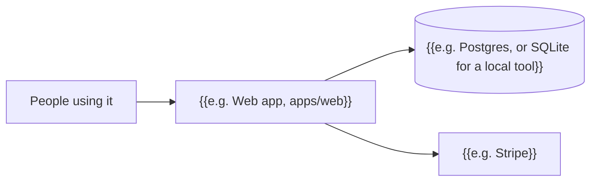

# Architecture

How the parts of {{PROJECT_NAME}} fit together. Agents read this before adding an app, a service, a table or an outside API, and update it in the same item. The phase-end review checks that it still matches the code.

## The picture

{{Replace with the real parts. Keep it to one screen.}}

## Parts

| Part | Folder | What it does | Talks to |
| --- | --- | --- | --- |
| {{e.g. Web app}} | `{{apps/web}}` | {{what it does}} | {{the database, Stripe}} |

## Data

{{The main tables or collections, one line each: what they hold, and who can read or write them. Point to the migrations folder.}}

## Outside services

| Service | Used for | Environment variables | Docs |
| --- | --- | --- | --- |
| {{e.g. Stripe}} | {{payments}} | `{{STRIPE_SECRET_KEY}}` | {{link}} |

## Key flows

{{The two or three flows that matter most, as short numbered steps. E.g. "Sign up: 1. The form posts to /api/signup. 2. ..."}}
